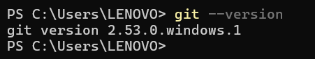
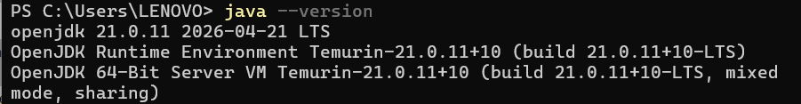
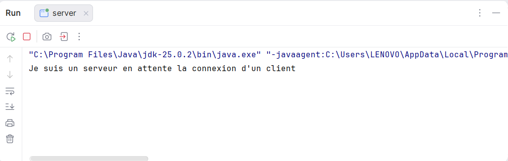
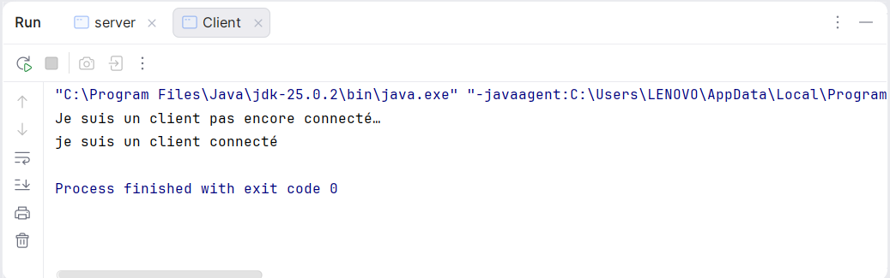
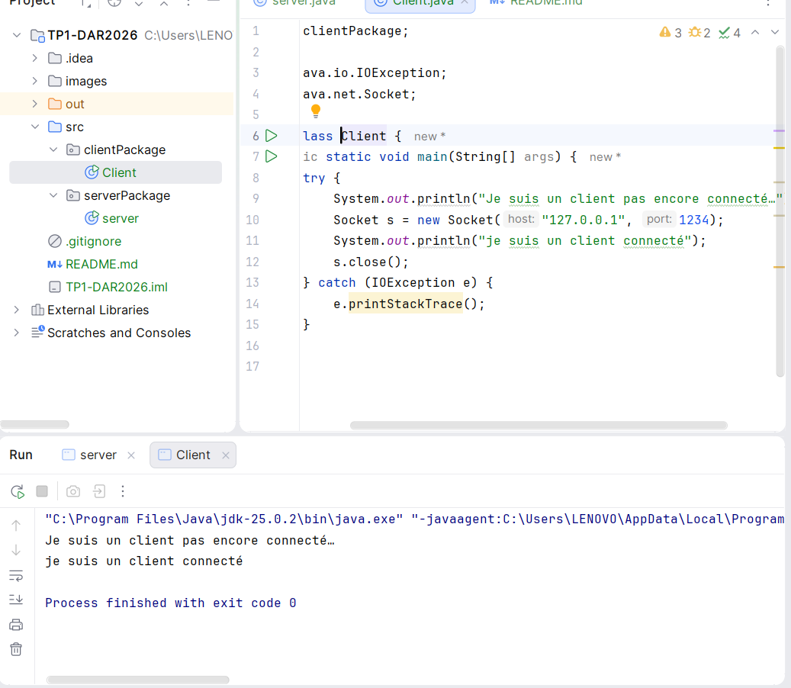
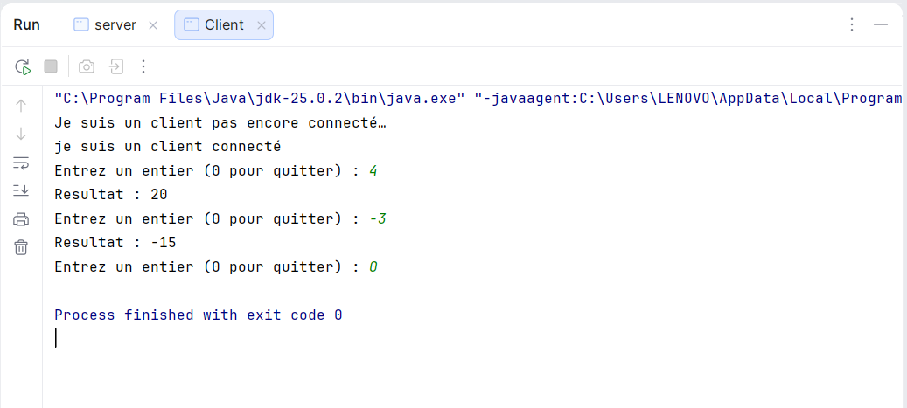
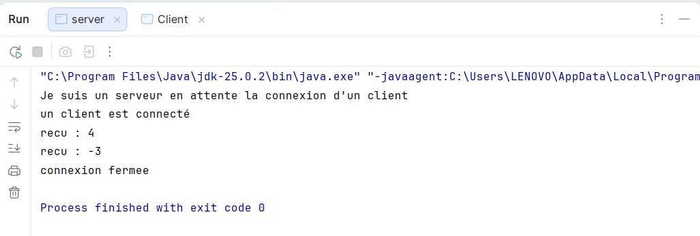

# TP1-DAR2026 - Sockets TCP en mode connecté

Nom Prénom - LSI3

## Activité 1-1 : Première connexion Client/Serveur

### Vérification de Git
J'ai vérifié que Git est installé avec la commande `git --version`.

### Vérification de Java
J'ai vérifié la version de Java avec `java --version`.

### Serveur
Le serveur se lance et attend la connexion d'un client sur le port 1234.

### Client
Le client se connecte au serveur, puis le serveur affiche "un client est connecté".

Test en remplaçant localhost par l'adresse IP :

## Activité 1-2 : Service de calculatrice

Le client envoie un entier x au serveur qui renvoie x * 5. J'utilise DataInputStream et DataOutputStream pour bien gérer les entiers négatifs. Quand le client saisit 0, la communication s'arrête et les sockets sont fermés des deux côtés.

- Test avec un entier positif :

- Test avec un entier négatif :

- Test avec 0 :

## Activité 1-3 : Amélioration

### Connexion entre deux machines
Le serveur est lancé sur une machine (IP : ...) et le client sur une autre machine du même réseau. J'ai utilisé InetAddress et InetSocketAddress.

### Calculatrice à quatre opérations
Le client choisit une opération dans un menu (addition, soustraction, multiplication, division), le serveur fait le calcul et renvoie le résultat. La division par zéro est gérée.

